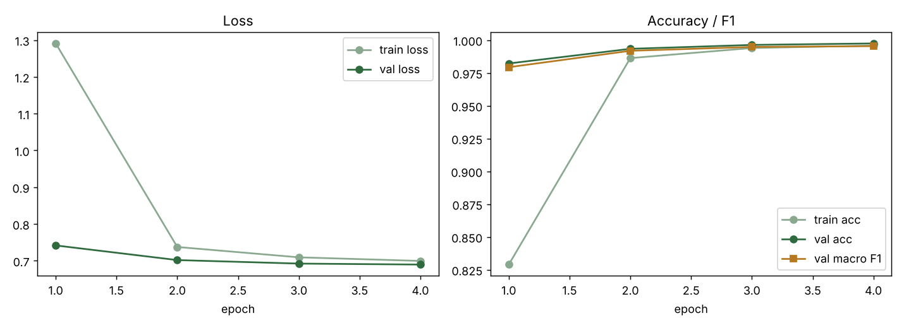
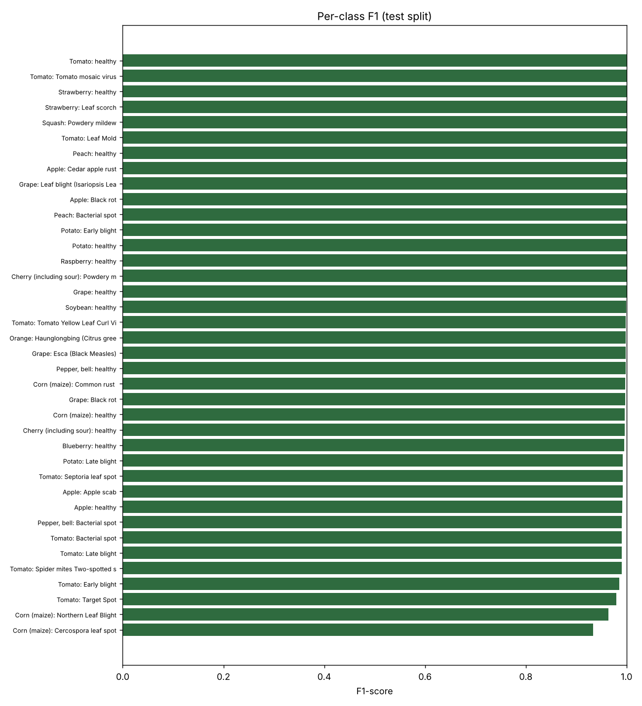
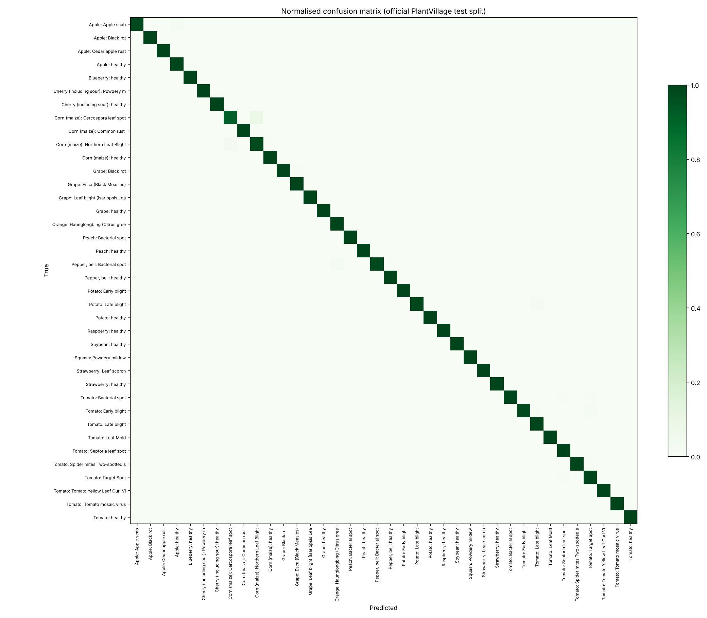

# Plant Doctor — Model Evaluation Report

Generated: 2026-11-16T13:27:14.240063+00:00  
Checkpoint: `plant_doctor_efficientnet_b0.pt` (best epoch 4)  
Model: EfficientNet-B0 (ImageNet-pretrained, fully fine-tuned), 38 classes, 224×224 input

## 1. Benchmark performance (PlantVillage official test split)

| Metric | Official test split | Strict subset (no leaf-ID overlap with train) |
|---|---|---|
| Images | 10709 | 10466 |
| Accuracy | 99.51% | 99.53% |
| Top-3 accuracy | 99.99% | 99.99% |
| Macro precision | 99.45% | 99.45% |
| Macro recall | 99.34% | 99.32% |
| Macro F1 | 99.39% | 99.38% |
| Weighted F1 | 99.51% | 99.53% |

The *strict subset* removes test images whose leaf identifier (from the dataset's leaf map) also occurs in the training/validation lists. The official split is kept for comparability with published results.

## 2. Training curves

| Epoch | Train loss | Train acc | Val loss | Val acc | Val macro F1 | Minutes |
|---|---|---|---|---|---|---|
| 1 | 1.2910 | 82.90% | 0.7416 | 98.22% | 97.94% | 33.3 |
| 2 | 0.7375 | 98.63% | 0.7018 | 99.34% | 99.19% | 31.1 |
| 3 | 0.7093 | 99.40% | 0.6923 | 99.64% | 99.48% | 31.3 |
| 4 | 0.6995 | 99.58% | 0.6897 | 99.75% | 99.54% | 30.1 |

## 3. Per-class F1 (test split)

| Class | Precision | Recall | F1 | Support |
|---|---|---|---|---|
| Apple___Apple_scab | 1.000 | 0.984 | 0.992 | 127 |
| Apple___Black_rot | 1.000 | 1.000 | 1.000 | 146 |
| Apple___Cedar_apple_rust | 1.000 | 1.000 | 1.000 | 52 |
| Apple___healthy | 0.993 | 0.990 | 0.991 | 286 |
| Blueberry___healthy | 0.994 | 0.997 | 0.995 | 324 |
| Cherry_(including_sour)___Powdery_mildew | 1.000 | 1.000 | 1.000 | 219 |
| Cherry_(including_sour)___healthy | 0.992 | 1.000 | 0.996 | 123 |
| Corn_(maize)___Cercospora_leaf_spot Gray_leaf_spot | 0.951 | 0.916 | 0.933 | 107 |
| Corn_(maize)___Common_rust_ | 1.000 | 0.995 | 0.998 | 217 |
| Corn_(maize)___Northern_Leaf_Blight | 0.955 | 0.973 | 0.964 | 220 |
| Corn_(maize)___healthy | 0.992 | 1.000 | 0.996 | 250 |
| Grape___Black_rot | 1.000 | 0.994 | 0.997 | 168 |
| Grape___Esca_(Black_Measles) | 0.996 | 1.000 | 0.998 | 284 |
| Grape___Leaf_blight_(Isariopsis_Leaf_Spot) | 1.000 | 1.000 | 1.000 | 204 |
| Grape___healthy | 1.000 | 1.000 | 1.000 | 100 |
| Orange___Haunglongbing_(Citrus_greening) | 0.997 | 1.000 | 0.998 | 980 |
| Peach___Bacterial_spot | 1.000 | 1.000 | 1.000 | 542 |
| Peach___healthy | 1.000 | 1.000 | 1.000 | 71 |
| Pepper,_bell___Bacterial_spot | 1.000 | 0.982 | 0.991 | 166 |
| Pepper,_bell___healthy | 1.000 | 0.996 | 0.998 | 283 |
| Potato___Early_blight | 1.000 | 1.000 | 1.000 | 164 |
| Potato___Late_blight | 1.000 | 0.986 | 0.993 | 212 |
| Potato___healthy | 1.000 | 1.000 | 1.000 | 32 |
| Raspberry___healthy | 1.000 | 1.000 | 1.000 | 162 |
| Soybean___healthy | 1.000 | 0.999 | 0.999 | 973 |
| Squash___Powdery_mildew | 1.000 | 1.000 | 1.000 | 378 |
| Strawberry___Leaf_scorch | 1.000 | 1.000 | 1.000 | 200 |
| Strawberry___healthy | 1.000 | 1.000 | 1.000 | 80 |
| Tomato___Bacterial_spot | 0.993 | 0.989 | 0.991 | 436 |
| Tomato___Early_blight | 0.995 | 0.977 | 0.986 | 215 |
| Tomato___Late_blight | 0.987 | 0.995 | 0.991 | 375 |
| Tomato___Leaf_Mold | 1.000 | 1.000 | 1.000 | 172 |
| Tomato___Septoria_leaf_spot | 0.988 | 0.997 | 0.993 | 337 |
| Tomato___Spider_mites Two-spotted_spider_mite | 0.988 | 0.994 | 0.991 | 320 |
| Tomato___Target_Spot | 0.969 | 0.990 | 0.979 | 288 |
| Tomato___Tomato_Yellow_Leaf_Curl_Virus | 1.000 | 0.997 | 0.999 | 1100 |
| Tomato___Tomato_mosaic_virus | 1.000 | 1.000 | 1.000 | 66 |
| Tomato___healthy | 1.000 | 1.000 | 1.000 | 330 |

**Weakest classes:** Corn_(maize)___Cercospora_leaf_spot Gray_leaf_spot (F1 0.933), Corn_(maize)___Northern_Leaf_Blight (F1 0.964), Tomato___Target_Spot (F1 0.979), Tomato___Early_blight (F1 0.986), Tomato___Spider_mites Two-spotted_spider_mite (F1 0.991)

**Most frequent confusions (true → predicted, count):** Corn_(maize)___Cercospora_leaf_spot Gray_leaf_spot → Corn_(maize)___Northern_Leaf_Blight (9); Corn_(maize)___Northern_Leaf_Blight → Corn_(maize)___Cercospora_leaf_spot Gray_leaf_spot (5); Tomato___Early_blight → Tomato___Target_Spot (4); Pepper,_bell___Bacterial_spot → Orange___Haunglongbing_(Citrus_greening) (3); Potato___Late_blight → Tomato___Late_blight (3)

## 4. Confusion matrix

## 5. Confidence and abstention on in-distribution data

* Mean top-1 softmax probability: 90.05%
* Test images below the 60.00% confidence threshold (would trigger abstention): 0.67%
* Accuracy among confident predictions: 99.75%
* Accuracy among low-confidence predictions: 65.28%

Softmax probabilities are **not** calibrated estimates of real-world correctness; they describe the model's relative preference among the 38 training classes only.

## 6. Novelty (out-of-distribution) detector

* Fitted on 7496 training images (200 per class), calibrated on 4389 validation images.
* Raw Mahalanobis distance percentiles on validation: p50=32.4, p90=47.6, p95=53.6, p99=68.7, p99.9=89.5
* Test images flagged as novel at the default limit: 0.89% (expected ≈1% by construction).

## 7. Benchmark vs. real-world performance (please read)

PlantVillage photographs were taken in controlled conditions: a single detached leaf on a uniform background, consistent lighting, no occlusion. The scores above therefore measure how well the model separates these 38 classes **under those conditions**. Published work (e.g. Mohanty et al. 2016) reports that accuracy of PlantVillage-trained models drops substantially on field photographs. Plant Doctor has **not** been evaluated on field images, and its outputs must be treated as screening suggestions, not diagnoses.

Known limitations: only 14 crops / 38 conditions are covered; co-infections, early asymptomatic stages, nutrient disorders and pest damage outside the class list cannot be recognised; the novelty detector only catches images that are far from the training distribution in feature space.
